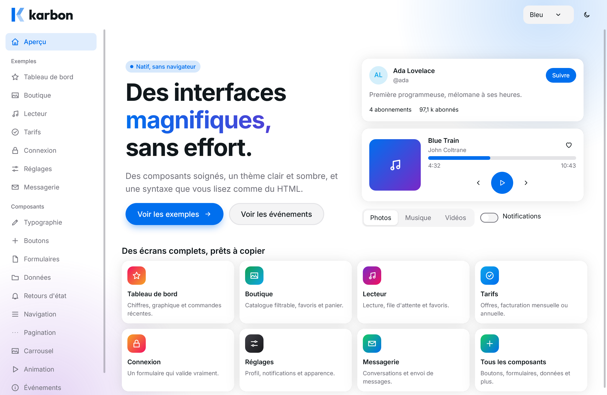
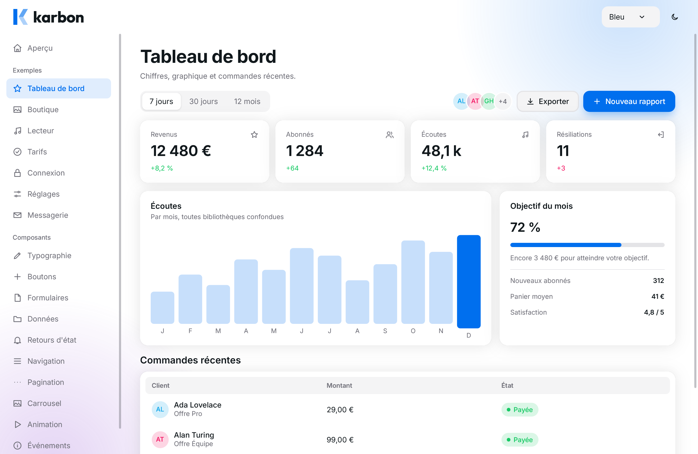
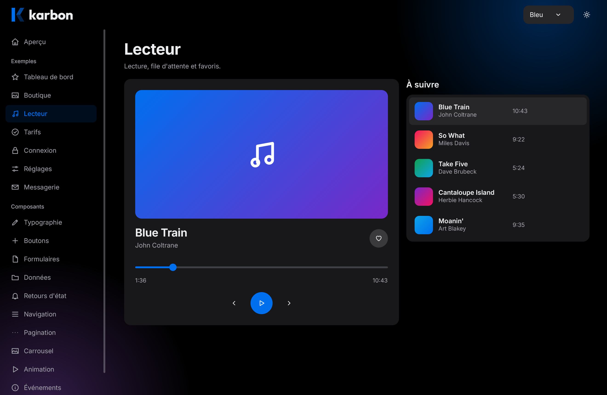
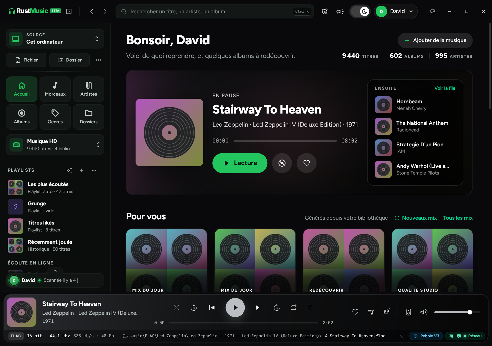
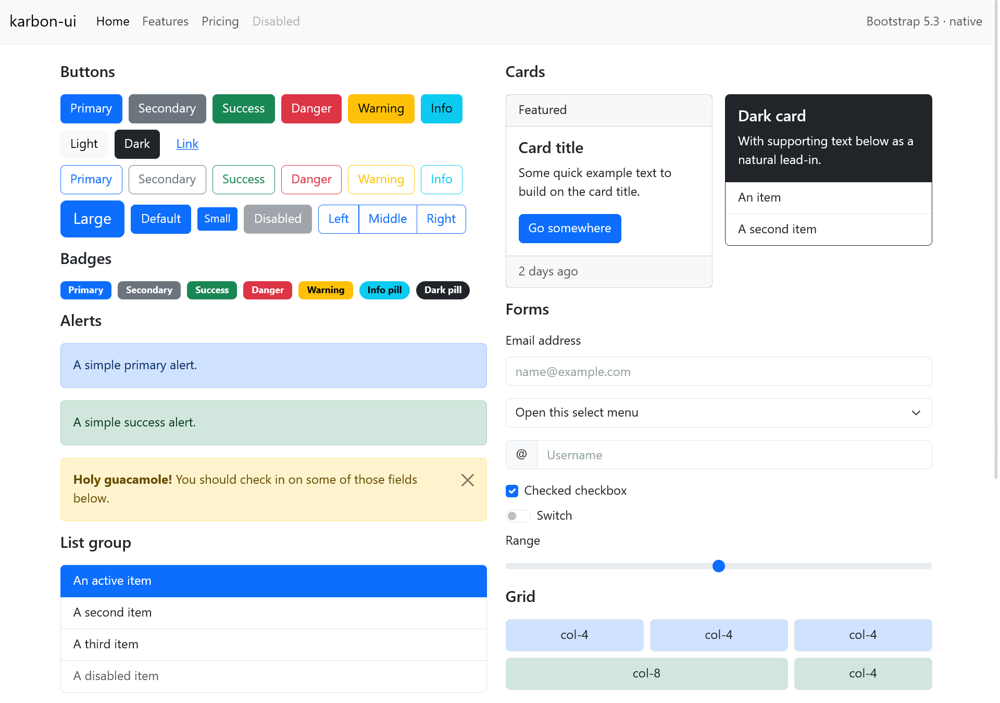

<p align="center">
  <picture>
    <source media="(prefers-color-scheme: dark)" srcset="docs/logo/logo-full-white.svg">
    
  </picture>
</p>

<p align="center">
  <b>Native desktop UI for Rust, written like the web.</b><br>
  HTML templates and CSS compiled to native widgets. No webview, no JavaScript, no runtime parser.
</p>

<p align="center">
  <a href="https://github.com/larevuegeek/karbon-ui/actions/workflows/ci.yml"></a>
  <a href="https://crates.io/crates/karbon-ui"></a>
  <a href="https://docs.rs/karbon-ui"></a>
  
  
</p>

<p align="center">
  
</p>

Karbon UI draws every pixel itself with the operating system's own graphics, text and
accessibility APIs. Views are written as HTML templates with a CSS subset (Tailwind
utilities and Bootstrap included), and all of it is **compiled to Rust at build time**:
the binary contains no HTML parser, no CSS engine and no browser.

- **No webview.** Direct2D on Windows, Metal on macOS, Vulkan on Linux, with a software
  fallback on each.
- **Familiar syntax.** `<div class="card">`, `{#if}`, `{#each}`, `onclick={Msg::Save}`,
  flexbox, grid, variables, media queries, transitions and keyframes.
- **Checked by the compiler.** In your own templates and stylesheets, an unknown tag,
  attribute, class or CSS property is a build error with its position, not a silent no-op
  at run time. An existing framework stylesheet is compiled leniently, with a report of
  what was skipped.
- **Native where it matters.** System text shaping, input methods, screen readers,
  clipboard, file dialogs, system colour scheme and reduced motion.
- **No third-party crates.** Only the vendors' official bindings (`windows`, the `objc2`
  family, `libc`); on Linux the desktop libraries are bound by hand.

> **Status: pre-alpha (0.1).** Karbon UI is the native UI layer written to replace Tauri in
> RustMusic, a desktop music player. It is a sibling of the
> [Karbon](https://github.com/larevuegeek/karbon) web framework and
> [KarbonJS](https://github.com/larevuegeek/karbonjs). The API will change, and the CSS
> coverage is a documented subset, not a browser.

## Screenshots

Every image below is an export of an example of this repository
(`--export image.png`), rendered without opening a window.

| | |
|---|---|
|  |  |
| The component kit: a dashboard (`kit_gallery`) | The same kit in the dark colour scheme |
|  |  |
| RustMusic's home, translated from Svelte + Tailwind (`rustmusic_html`) | The stock Bootstrap 5.3 stylesheet, compiled (`bootstrap_demo`) |

## Platforms

| | Windows | macOS | Linux |
|---|---|---|---|
| Windows & input | Win32, DirectComposition | AppKit | Wayland, or X11 (XCB) |
| Text | DirectWrite | Core Text | Pango / HarfBuzz |
| Rendering | Direct2D (GPU or WARP) | Metal, Core Graphics fallback | Vulkan, Cairo fallback |
| Accessibility | UI Automation | NSAccessibility | AT-SPI |
| Input methods | IME | NSTextInputClient | text-input-v3, IBus |

## Getting started

```sh
cargo add karbon-ui
```

Rust 1.89 or later. Windows and macOS need nothing else. Linux links against the desktop
libraries at build time (Debian/Ubuntu):

```sh
sudo apt install libcairo2-dev libpango1.0-dev libgdk-pixbuf-2.0-dev libfontconfig-dev \
                 libfreetype-dev libwayland-dev libxkbcommon-dev libdbus-1-dev
```

XCB (X11), Vulkan and the cursor and XInput libraries are loaded at run time with
`dlopen`: a system without X11 or without a Vulkan driver still starts.

### A minimal application

```rust
use karbon_ui::{platform, ui::prelude::*, window::WindowOptions};

#[derive(Clone)]
enum Msg {
    NameChanged(String),
    Save,
}

#[derive(Default)]
struct App {
    name: String,
    saved: bool,
}
impl Application for App {
    type Message = Msg;
    fn view(&self, _: &ViewContext) -> Element {
        column("page", [
            Text::new("My application").size(24.).bold().element("title"),
            input("name", self.name.as_str(), Msg::NameChanged),
            button("save", "Save", Msg::Save),
            text("status", if self.saved { "Saved" } else { "" }),
        ])
        .padding(24)
        .gap(12.)
    }
    fn update(&mut self, message: Msg) -> bool {
        match message {
            Msg::NameChanged(name) => self.name = name,
            Msg::Save => self.saved = true,
        }
        true // rebuild the view
    }
}

fn main() -> karbon_ui::Result<()> {
    platform::run(WindowOptions::DEFAULT, App::default())
}
```

### The same view as a template

A `.ui` file, or the `ui!` macro: the markup is translated to native calls at compile
time, Rust stays between braces.

```html
<main class="page">
  <h1>My application</h1>
  <input type="text" value={self.name.as_str()} oninput={Msg::NameChanged}>
  <button onclick={Msg::Save}>Save</button>
  {#if self.saved}<p>Saved, <b>{self.name}</b>!</p>{/if}
</main>
```

Each window has its own `Message` type. Simple actions (`button`, menu items, `on_dismiss`…)
receive a message cloned on every activation; value-carrying widgets receive a function, so
a tuple variant is enough (`Msg::NameChanged`). Fallible APIs return `karbon_ui::Result<T>`
with a typed `karbon_ui::Error` that converts to and from `std::io::Error`.

### Ready-made components

`ui::kit` provides styled components written like HTML, grouped by type: layout,
typography, buttons, forms, data, feedback, navigation, pagination, carousel, animation
and overlays. They follow the light or dark colour scheme and are customised with a theme,
attributes or your own classes.

```rust,ignore
use karbon_ui::ui::kit::prelude::*;

ui! {
    <Stack gap="lg" padding="xl">
        <Input label="Name" value={&self.name} oninput={Msg::Name} />
        <Button primary icon="plus" onclick={Msg::Add}>Add</Button>
    </Stack>
}
```

`cargo run --release --example kit_gallery` shows them all; see
[docs/kit.md](docs/kit.md) (in French).

## How it works

1. `Application::view()` builds a tree of `Element`s (Rust constructors or templates).
2. The runtime resolves the CSS cascade (inheritance, `:hover`/`:focus` states, media
   queries, variables), then lays the tree out — only when geometry changed.
3. Widgets paint into a `Scene`, an OS-independent list of draw commands.
4. The platform backend turns the scene into pixels and presents the surface.
5. Native input comes back as `UiEvent`s; the runtime finds the handler in the current
   tree, builds a message and calls `update`. Returning `true` rebuilds the view.

Replacing the tree replaces its handlers: no global registry, no stale identifiers.
The engine keeps memoisations (layout measures within a pass, text measures across
frames, pointer facts for the cascade, memoised subtrees) that are verified not to change
the result. [docs/architecture.md](docs/architecture.md) is the map of the code.

## Examples

```sh
cargo run --release --example kit_gallery      # the component kit: full screens and every component
cargo run --release --example rustmusic_html   # RustMusic home, translated from Svelte + Tailwind
cargo run --release --example bootstrap_demo   # Bootstrap 5.3 compiled as a framework stylesheet
cargo run --example simple_ui                  # the Rust API
cargo run --example multi_window               # several windows
cargo run --example background_task            # a background task and its wake-up
cargo run --example system_dialogs             # native file dialogs
```

`kit_gallery`, `rustmusic_html`, `bootstrap_demo`, `simple_ui` and `system_dialogs` accept
window options after `--` (`--renderer=gpu|software`, `--profile`…); the first three also
export an image without opening a window (`--export x.png --size 1280x900`).

## Checking

```sh
cargo fmt --all --check
cargo clippy --workspace --all-targets -- -D warnings
cargo test --workspace --all-targets
cargo test --doc --workspace
cargo doc --no-deps --workspace
```

The engine's contract (about 370 unit tests, including the window-less `HeadlessApp`
harness) runs on every target; each backend adds its own suite, the compiler has about 90
tests, and the template and CSS crates in `tests/` add about 160 integration tests. Two
reference exports (`rustmusic_html` at 1280×900 and 960×700, software renderer) must stay
byte-identical across refactors. From Windows, `cargo clippy --target
x86_64-unknown-linux-gnu` and `--target x86_64-apple-darwin` check the other backends.

## Documentation

The API reference is on [docs.rs](https://docs.rs/karbon-ui). The guides are written in
French, in [docs/](docs/): templates ([templates.md](docs/templates.md),
[html-syntax.md](docs/html-syntax.md)), CSS coverage ([css.md](docs/css.md),
[tailwind.md](docs/tailwind.md), [css-frameworks.md](docs/css-frameworks.md)), the
component kit ([kit.md](docs/kit.md)), windows, tasks, images, drag-and-drop,
accessibility, headless testing ([headless.md](docs/headless.md)), the test organisation
([tests.md](docs/tests.md)) and the resume point ([next-session.md](docs/next-session.md)).
[tools/vscode-karbon-ui](tools/vscode-karbon-ui/README.md) adds `.ui` syntax highlighting,
indentation and snippets to VS Code.

## License

Licensed under either of [Apache License, Version 2.0](LICENSE-APACHE) or
[MIT license](LICENSE-MIT) at your option. Unless you explicitly state otherwise, any
contribution intentionally submitted for inclusion in the work by you, as defined in the
Apache-2.0 license, shall be dual licensed as above, without any additional terms or
conditions.

The examples embed third-party fonts and icons under their own licences: see
[examples/rustmusic_html/assets/SOURCES.md](examples/rustmusic_html/assets/SOURCES.md) and
[examples/rustmusic_html/icons/LICENSES.md](examples/rustmusic_html/icons/LICENSES.md).
